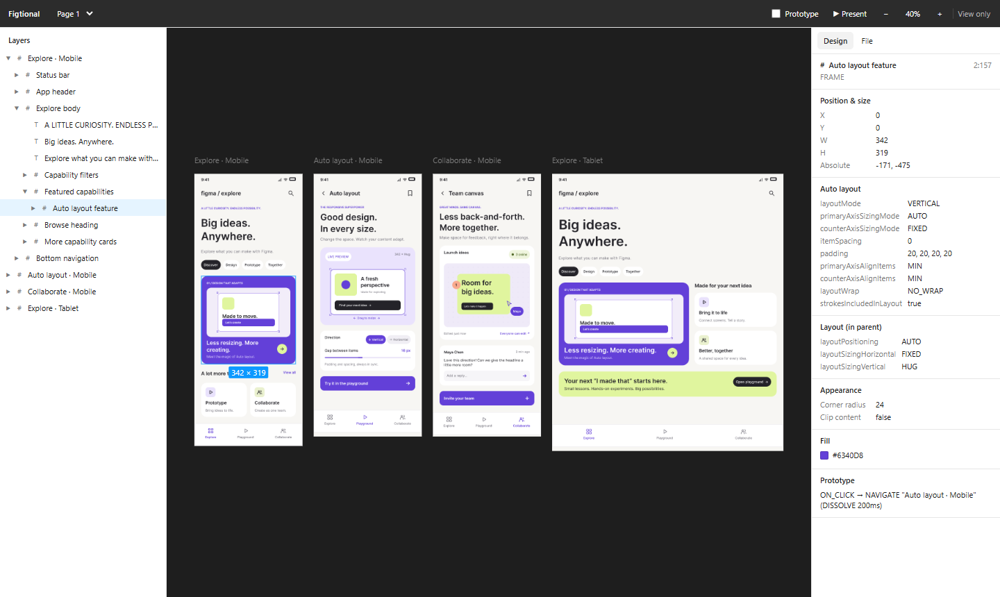

# Figtional MCP

**Figtional MCP** is a local MCP server that lets AI agents read and edit Figma `.fig` export files as if they were connected to Figma, but limited to the files *you* choose.

The official Figma MCP server gives an agent access to every file in your Figma account. Figtional works on local `.fig` exports instead: you export the file(s) you want to share, point Figtional at them, and the agent sees only those files. Nothing leaves your machine.

Use it to:
- **Practise working with Figma MCP** in a safe environment. The tools have the same names, parameters and behaviour as Figma's, so what you learn carries over.
- **Edit Figma files locally** with an AI agent, then import the result back into Figma.

It also includes a read-only **web viewer** that shows `.fig` files the way Figma does, with pages, layers, an inspect panel and a prototype preview.



> **Status:** early development, usable for testing. All of Figma MCP's read tools work, the viewer works, and `use_figma` supports a growing subset of the Plugin API for editing (see [Limitations](#limitations)). The roadmap is in [PLAN.md](PLAN.md).

## Contents

- [Features](#features)
- [Quick start](#quick-start)
  1. [Prerequisites](#1-prerequisites)
  2. [Install](#2-install)
  3. [Export a `.fig` file from Figma](#3-export-a-fig-file-from-figma)
  4. [Connect your AI agent](#4-connect-your-ai-agent)
  5. [Watch the files in the viewer](#5-watch-the-files-in-the-viewer)
- [Using the MCP server](#using-the-mcp-server)
- [Editing with `use_figma`](#editing-with-use_figma)
- [The web viewer](#the-web-viewer)
- [Other commands](#other-commands)
- [Limitations](#limitations)
- [How it works](#how-it-works)
- [Development](#development)

## Features

- **Figma-compatible MCP tools**: `whoami`, `get_metadata`, `get_design_context` (React + Tailwind or HTML/CSS), `get_screenshot`, `get_variable_defs`, `search_design_system`, `get_libraries`, `get_code_connect_map`, `create_design_system_rules` and `use_figma`, with the same names and parameters as the official Figma MCP server, so existing prompts and Figma's own agent skills keep working.
- **Editing** through Figma's Plugin API (`use_figma`): frames, auto layout, shapes, text, pages, variables, components with properties and variants. Changes are saved straight to the `.fig` file, which you can import back into Figma.
- **Explicit scope**: one file, a list of files, or a folder of `.fig` files. Nothing else is visible to the agent, and files are read-only unless you allow edits.
- **Library support**: library components, styles and variables that Figma embeds in the export work normally.
- **Web viewer**: pages, layers, an inspect panel, prototype arrows and a click-through preview. It reloads when an agent changes the file.
- **Fully local**: no Figma account, no network access. Runs on Windows, macOS and Linux.

## Quick start

### 1. Prerequisites

| You need | Version | Check with |
|---|---|---|
| [Node.js](https://nodejs.org/) (includes npm) | **22.15 or newer** (LTS 22 or 24 recommended) | `node --version` |
| [Git](https://git-scm.com/) | any recent | `git --version` |
| An MCP-capable AI client | e.g. Claude Code, Claude Desktop, Cursor or VS Code with GitHub Copilot | |
| A Figma account | only to export `.fig` files and import edited ones | |

Optional: install the fonts your designs use. Text that hasn't been edited always looks right, but edited or new text is measured and drawn with the fonts on your machine (missing fonts fall back to a basic font).

### 2. Install

```bash
git clone https://github.com/JoelSaarimaki/figtional-mcp.git
cd figtional-mcp
npm install
npm run build
```

Check that it works:

```bash
npx figtional --version
npx figtional --help
```

`npx figtional` works anywhere **inside** the repository folder. Figtional isn't published to npm yet, so MCP clients should start it with Node and the full path to `packages/cli/dist/bin.js`, as shown below. If you'd like a `figtional` command everywhere, run `npm link` inside `packages/cli`.

After pulling new changes, run `npm install` and `npm run build` again.

### 3. Export a `.fig` file from Figma

In Figma, open the file and choose **Main menu → File → Save local copy…**. Put the `.fig` file in a folder of its own, for example `C:\designs\` or `~/designs/`. If the file uses shared libraries, the parts it uses are included in the export.

To bring edits back into Figma later, drag the edited `.fig` into the Figma file browser (or use **Import**). This creates a **new** Figma file: comments, version history and links to the original file are not carried over.

### 4. Connect your AI agent

Figtional is an MCP server that talks over **stdio**: the AI client starts it as a command. Every client needs the same three things:

- **command**: `node`
- **args**: the full path to `packages/cli/dist/bin.js` in your clone, then `mcp`, then the files or folders the agent may use. Add `--writable` to allow edits.
- Use **absolute paths**. In JSON on Windows, write paths with forward slashes (`C:/Users/me/designs`) or doubled backslashes.

The examples use these placeholders. Replace them with your own paths:

- `/path/to/figtional-mcp` is where you cloned the repository, e.g. `C:/Users/me/GIT/figtional-mcp`.
- `/path/to/designs` is the folder with your `.fig` files.

> **Keep the real Figma MCP server switched off** while you practise with Figtional, so the agent can't reach your Figma account through it. Both servers use the same tool names, so with both connected the agent could pick either.

#### Claude Code

From the folder you want to work in:

```bash
claude mcp add figtional -- node /path/to/figtional-mcp/packages/cli/dist/bin.js mcp --writable /path/to/designs
```

Or add a `.mcp.json` file to the project folder, which you can share with your team:

```json
{
  "mcpServers": {
    "figtional": {
      "command": "node",
      "args": ["/path/to/figtional-mcp/packages/cli/dist/bin.js", "mcp", "--writable", "/path/to/designs"]
    }
  }
}
```

Start Claude Code in that folder and check the connection with `/mcp` (a server from a shared `.mcp.json` asks for approval first). If you also install Figma's official Claude Code plugin for its skills (`figma:figma-use`, `figma:figma-design-to-code`, …), disable its Figma MCP server for this project, as noted above; the skills then guide the agent while it uses Figtional's tools.

#### Claude Desktop

Edit `claude_desktop_config.json` (Settings → Developer → Edit Config) and restart Claude Desktop:

```json
{
  "mcpServers": {
    "figtional": {
      "command": "node",
      "args": ["/path/to/figtional-mcp/packages/cli/dist/bin.js", "mcp", "--writable", "/path/to/designs"]
    }
  }
}
```

#### Cursor

Add the same `mcpServers` block to `.cursor/mcp.json` in your project (or to `~/.cursor/mcp.json` for all projects).

#### VS Code (GitHub Copilot agent mode)

Add `.vscode/mcp.json` to your project:

```json
{
  "servers": {
    "figtional": {
      "type": "stdio",
      "command": "node",
      "args": ["/path/to/figtional-mcp/packages/cli/dist/bin.js", "mcp", "--writable", "/path/to/designs"]
    }
  }
}
```

#### Other clients

Any MCP client that can start a stdio server works with the same command and arguments.

#### First prompts to try

- "Use the figtional MCP server. Call `whoami` and list the pages of my file with `get_metadata`."
- "Implement the frame called *Home* as a React component." (uses `get_design_context` and `get_screenshot`)
- "With `use_figma`, add a card with a title and a button next to the existing screens."

`whoami` lists the files the agent can use and their **file keys**. Agents can also use Figma-style URLs: `https://www.figma.com/design/<file key>/Any-name?node-id=1-4`.

### 5. Watch the files in the viewer

In a second terminal, inside the repository folder:

```bash
npx figtional serve /path/to/designs
```

Open <http://127.0.0.1:3846>. The viewer reloads whenever the agent saves a change, so you can watch edits as they happen.

## Using the MCP server

Choose what the agent can access when you start the server: one file, several files, or every `.fig` file in a folder.

```bash
figtional mcp ./designs/App.fig                          # one file, read-only
figtional mcp ./designs/App.fig ./designs/Marketing.fig  # specific files
figtional mcp ./designs/                                 # every .fig directly in the folder
figtional mcp --recursive ./designs/                     # ...and in its subfolders
figtional mcp --writable ./designs/App.fig               # allow edits
figtional mcp --writable --out ./edited ./designs/App.fig   # save edits to copies in ./edited
figtional mcp --extra-tools ./designs/                   # also enable Figtional-only helper tools
```

(Inside the repository use `npx figtional …`; elsewhere `node /path/to/figtional-mcp/packages/cli/dist/bin.js …`.)

- **Scope.** Nothing outside the given files and folders is reachable. Folder contents are checked on every use, so `.fig` files added later appear automatically. Symlinks pointing out of the folder are ignored.
- **Read-only by default.** `--writable` allows `use_figma` edits. Each saved edit keeps the previous version as `<file>.fig.bak`, or use `--out <dir>` to leave the originals untouched.
- **File keys.** A file's key is its file name as a slug (`My App.fig` → `my-app`). Files from subfolders get the folder in the key with `--` (`archive--old-landing`).
- **Extra tools.** `--extra-tools` (or `--extra-tools=figtional_find_nodes,…`) adds Figtional-only tools: `figtional_list_files`, `figtional_list_pages`, `figtional_find_nodes`, `figtional_get_node_json`. They're off by default so the tool set matches Figma MCP's.
- **Assets.** `get_design_context` serves the images and vector exports it references from a local asset server on `http://localhost:3845` (or a free port), as Figma's desktop MCP server did. It only serves assets from files in scope.

You can also put the sources in a config file and start with `figtional mcp --config figtional.config.json`:

```json
{
  "sources": [
    { "file": "./designs/App.fig", "key": "app", "writable": true },
    { "file": "./designs/Marketing.fig" },
    { "dir": "./designs/archive", "recursive": true }
  ],
  "outDir": "./edited",
  "extraTools": false
}
```

Relative paths in the config file are relative to the config file.

## Editing with `use_figma`

With `--writable`, the agent sends Plugin API code, exactly as with Figma MCP:

```js
await figma.loadFontAsync({ family: "Inter", style: "Semi Bold" });
const card = figma.createAutoLayout("VERTICAL", { itemSpacing: 12, paddingLeft: 24, paddingRight: 24 });
const title = figma.createText();
title.fontName = { family: "Inter", style: "Semi Bold" };
title.characters = "Hello";
card.appendChild(title);
return { id: card.id };
```

- **Saved immediately.** Each successful call is saved to the file (or to `--out`), as Figma applies edits live.
- **All or nothing.** A call that throws changes nothing. (Figma can leave partial edits behind; Figtional doesn't.)
- **Laid out like Figma.** Text is measured with your installed fonts and auto layout is recalculated immediately, so sizes read in the same script, screenshots and the viewer show the result. Figma recalculates text layout itself when you import the file.
- **Supported:**
  - frames, auto layout and layout sizing,
  - rectangles, ellipses and lines,
  - text (content, fonts, sizes, ranges),
  - fills, strokes, effects and corner radii,
  - pages,
  - variables (collections, modes, values, binding to fills and spacing),
  - components and instances, component properties (text, boolean, instance swap), variants (`combineAsVariants`, `setProperties`) and `detachInstance`,
  - text, visibility and fill changes inside instances,
  - `node.query()`, `node.set()` and `node.screenshot()`.

  Figma's rules and error messages are copied, for example "load fonts before editing text".
- **Unsupported calls** fail with `NotSupportedInFigtional: …`. That's a Figtional limitation, not necessarily a Figma one.

## The web viewer

```bash
figtional serve                       # every .fig below the current folder
figtional serve ./designs/            # a folder (subfolders included)
figtional serve ./designs/App.fig     # one file
figtional serve --port 4000 ./designs/
```

- **Top bar:** file switcher, page selector, zoom, the **Prototype** toggle (connection arrows) and **Present** (click through prototype flows; a basic version of Figma's prototype player).
- **Left:** the layer tree. **Right:** the inspect panel (position, auto layout, fills, text, components, variables, prototype) and a **File** tab with variables per mode and styles.
- **Canvas:** drag to pan, scroll to move, Ctrl/Cmd + scroll to zoom. Click selects a layer; Ctrl/Cmd-click selects the deepest layer. Shift+1 zooms to fit, Shift+2 zooms to the selection.
- **Links:** `?file=<key>&page=<id>&node-id=1-4`, plus `&proto=1` or `&present=1`.
- **Read-only, local.** It only listens on `127.0.0.1` and reloads when files change on disk.
- **Without arguments** it serves every `.fig` below the current folder. To avoid long scans it refuses drive roots, your home folder and system folders, and stops after 2,000 folders.

## Other commands

```bash
figtional dump App.fig            # pages, node counts, format version
figtional inspect App.fig 1:4     # a node as an XML outline; --json for the decoded data
figtional validate App.fig        # format version and a byte-for-byte round-trip check
figtional help <command>          # help for one command (or: figtional <command> --help)
```

## Limitations

- **Plugin API subset.** `use_figma` supports a subset of the Plugin API. Not supported yet: creating styles, vectors/SVG import, adding new images, prototype interactions, plugin data.
- **Not a sandbox.** The `use_figma` runtime (Node's `vm`) keeps scripts away from `require`, files and the network by convention, but it is not a security boundary. The access boundary is the file scope you start Figtional with.
- **Rendering.** Screenshots and the viewer are visually faithful but not pixel-identical to Figma. Background blur isn't drawn, and angular/diamond gradients are approximated.
- **Fonts.** Text that hasn't been edited is drawn exactly as Figma laid it out. Edited or new text uses **fonts installed on your machine**. If a font is missing, Figtional falls back to a basic font for display, but the file keeps the original font, so Figma shows it correctly after import.
- **Present mode is basic.** It follows clicks, overlays and back/close, but lacks Smart Animate, most transitions, other triggers and Figma's hotspot hints.
- **Not in `.fig` files.** No Code Connect, comments, version history or multiplayer. Those live in Figma's cloud.

## How it works

A `.fig` export is a ZIP archive containing `canvas.fig` (Figma's binary **fig-kiwi** document), `meta.json`, `thumbnail.png` and an `images/` folder.

- **Reading.** Figtional decodes `canvas.fig` with the schema embedded in the file itself and builds a document tree, resolving components, instances, styles and variables.
- **Writing.** It re-encodes the document with the same schema, so files round-trip byte for byte and import cleanly into Figma.

What's known about the format is in [docs/fig-format.md](docs/fig-format.md), and the design is in [PLAN.md](PLAN.md).

## Development

```bash
npm install
npm run build      # compile all packages
npm test           # unit tests (run against the sources; no build needed)
npm run lint
npm run format
```

- **Packages:** `fig-format` (file format), `fig-model` (document, layout, editing), `fig-render` (SVG/PNG), `mcp-server` (tools and `use_figma`), `viewer` and `cli`, all under `packages/`.
- **Reference files.** Tests that compare against real Figma exports use a local, git-ignored `references/` folder (`.fig` files with Figma's PNG/SVG exports of their frames). Those tests skip when the files are missing.
- **Contributing.** See [CONTRIBUTING.md](CONTRIBUTING.md) for how to contribute, and [docs/compat-log.md](docs/compat-log.md) for Figma import checks.

## License

[MIT](LICENSE)

## Disclaimer

Figtional is an independent project. It is not affiliated with or endorsed by Figma, Inc. "Figma" is a trademark of Figma, Inc.
